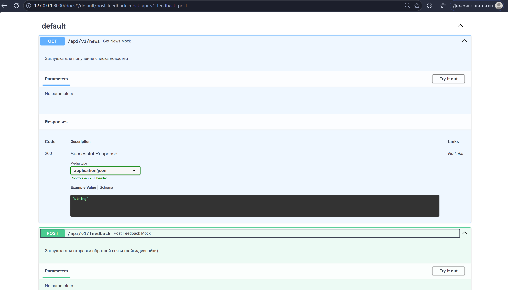

# alphaHak - Backend Service

Базовый REST API на FastAPI для работы с новостями и обратной связью.

## 🛠️ Быстрый запуск

1. Установите зависимости:
   ```bash
   pip install -r requirements.txt
   ```
2. Запустите сервер разработки:
   ```bash
   uvicorn app.main:app --reload
   ```

Интерактивная документация API доступна по адресу: http://127.0.0

## 📸 Текущий прогресс (Swagger UI)




